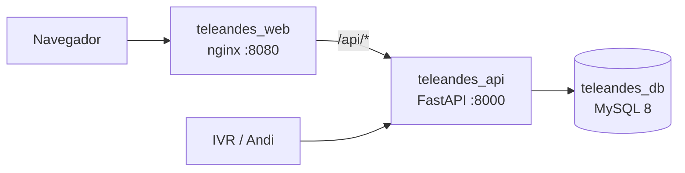

# TeleAndes – Atención al cliente

Solución para TeleAndes, operador de internet y telefonía, que atiende a sus clientes por tres canales: IVR, WhatsApp (el asistente Andi) y asesores humanos. Este repositorio contiene:

- **API REST** (FastAPI + MySQL): consulta de clientes y registro e historial de gestiones. Es la fuente única que usan los tres canales.
- **Formulario del agente** (HTML + CSS + JS sin frameworks): consulta un cliente por documento, muestra su ficha y su historial, y registra una gestión.
- **Diseño del IVR** ([docs/ivr.md](docs/ivr.md)): reglas, diagrama de flujo, pseudocódigo, lectura de cifras y dialplan ilustrativo de Asterisk.
- **Diseño de Andi** ([docs/andi.md](docs/andi.md)): prompt de sistema, herramientas, casos de conversación, cambios al voicebot y seguridad y operación.

## Arquitectura

La API sigue una arquitectura por capas (hexagonal): el dominio no conoce FastAPI ni MySQL, y las dependencias apuntan hacia adentro.



| Capa | Contenido |
|---|---|
| `domain` | Entidades (`Cliente`, `Gestion`), value objects (`Documento`, `Canal`, `Tipificacion`), puertos (repositorios) y excepciones. Aquí viven las reglas de negocio. |
| `application` | Casos de uso: consultar cliente, registrar gestión, listar gestiones. |
| `infrastructure` | Adaptadores MySQL con SQLAlchemy Core y manejo de conexiones. |
| `api` | Routers, esquemas, inyección de dependencias y manejo de errores. |

Servicios de Docker Compose:

| Servicio | Puerto | Función |
|---|---|---|
| `teleandes_db` | (interno) | MySQL 8. Crea el esquema y los datos de ejemplo en el primer arranque. |
| `teleandes_api` | 8000 | Solo REST. No sirve archivos estáticos. |
| `teleandes_web` | 8080 | nginx: sirve el formulario y reenvía `/api/` a la API. |

```text
teleandes/
├── backend/            API (Python 3.11)
│   ├── src/            domain · application · infrastructure · api
│   ├── config/         settings y logging
│   └── tests/          unit/ e integration/
├── frontend/           formulario del agente + nginx.conf
├── database/           01_schema.sql, 02_seed.sql
├── docs/               ivr.md, andi.md, pruebas-curl.md
├── docker-compose.yml
└── .env.example
```

## Requisitos

- Docker y Docker Compose v2 (para ejecutar todo el sistema).
- Python 3.11 y Node.js 18 o superior (solo para correr las pruebas fuera de Docker).

## Cómo ejecutarlo

```bash
cp .env.example .env        # en PowerShell: Copy-Item .env.example .env
docker compose up -d --build
```

Cambie las claves de `.env` si lo desea; los valores de ejemplo son ficticios.

| URL | Qué es |
|---|---|
| http://localhost:8080 | Formulario del agente |
| http://localhost:8000/health | Salud de la API (también `/docs` para Swagger) |

Clientes de ejemplo para probar el formulario: `1020304050` (Laura Gómez, activa), `52123456` (Carlos Pérez, suspendido, con saldo y corte vencido) y `79876543` (Ana Ruiz, activa). Un documento inexistente, como `999999`, muestra el error 404.

Reiniciar desde cero, borrando la base de datos (el esquema y los datos de ejemplo solo se cargan con el volumen vacío):

```bash
docker compose down -v
docker compose up -d --build
```

Ver los logs: `docker compose logs -f teleandes_api`. Detener sin borrar datos: `docker compose down`.

### Ejecución local sin Docker

Requiere un MySQL 8 propio con `database/01_schema.sql` y `database/02_seed.sql` cargados, y un archivo `backend/.env` con `DB_HOST`, `DB_PORT`, `DB_NAME`, `DB_USER` y `DB_PASSWORD`.

```bash
cd backend
python -m venv .venv
.venv/bin/pip install -r requirements.txt        # en Windows: .venv\Scripts\pip
.venv/bin/uvicorn src.api.main:app --port 8000
```

En este modo solo corre la API; para el formulario use el servicio `teleandes_web` o sirva `frontend/` con cualquier servidor estático que reenvíe `/api/` a la API.

## Pruebas

Las pruebas de la API no necesitan base de datos ni Docker.

```bash
cd backend
python -m venv .venv
.venv/bin/pip install -r requirements-dev.txt    # en Windows: .venv\Scripts\pip
.venv/bin/python -m pytest                       # 99 pruebas
```

Las pruebas del formulario (funciones de formato de la interfaz) usan el ejecutor integrado de Node:

```bash
cd frontend
node --test                                      # 7 pruebas
```

## Endpoints

Todos los errores tienen la forma `{"error": "mensaje"}`: 400 para datos inválidos (incluye los 422 de validación), 404 para recursos inexistentes, 503 si la base de datos no responde y 500 genérico sin detalles internos. Más ejemplos de error en [docs/pruebas-curl.md](docs/pruebas-curl.md).

| Método y ruta | Respuestas |
|---|---|
| `GET /health` | 200, 503 |
| `GET /api/clientes/{documento}` | 200, 400, 404, 503 |
| `POST /api/gestiones` | 201 (nueva), 200 (repetida por clave), 400, 404, 503 |
| `GET /api/gestiones?documento=` | 200, 400, 404, 503 |

### GET /api/clientes/{documento}

```bash
curl http://localhost:8000/api/clientes/79876543
```
```json
{"documento":"79876543","nombre":"Ana Ruiz","celular":"3155550101","plan":"Hogar 500 Mb + TV","estado":"activo","saldo":120500,"fecha_corte":"2026-11-15"}
```
Error (404): `{"error":"No existe un cliente con documento 999999"}`

### POST /api/gestiones

Canales: `ivr`, `whatsapp`, `agente`. Tipificaciones: `Consulta de saldo`, `Consulta de estado`, `Reclamo`, `Solicitud de asesor`, `Otro`. La observación admite hasta 1000 caracteres y es obligatoria para `Reclamo`. Si se envía la cabecera opcional `Idempotency-Key` (máximo 64 caracteres), repetir la petición con la misma clave no crea otra gestión.

```bash
curl -X POST http://localhost:8000/api/gestiones \
  -H "Content-Type: application/json" -H "Idempotency-Key: demo-001" \
  -d '{"documento":"79876543","canal":"agente","tipificacion":"Reclamo","observacion":"Cobro duplicado"}'
```
201 la primera vez; 200 con el mismo cuerpo si se repite la clave:
```json
{"id":1,"fecha":"2026-11-02T10:30:00.123-05:00"}
```
Error (400): `{"error":"La observación es obligatoria cuando la tipificación es Reclamo"}`

Para `ivr` y `whatsapp` el `documento` es opcional (ver supuestos); en ese caso la `observacion` es obligatoria.

### GET /api/gestiones?documento=

Historial del cliente, la gestión más reciente primero. Un cliente sin gestiones devuelve `[]`.

```bash
curl "http://localhost:8000/api/gestiones?documento=79876543"
```
```json
[{"id":1,"documento":"79876543","canal":"agente","tipificacion":"Reclamo","observacion":"Cobro duplicado","fecha":"2026-11-02T10:30:00.123-05:00"}]
```
Error (400, sin el parámetro): `{"error":"El parámetro documento es obligatorio"}`

## Decisiones técnicas

- **MySQL 8.** Los datos son relacionales (clientes y sus gestiones) y se necesita integridad referencial y una restricción UNIQUE para la idempotencia. Se accede con SQLAlchemy Core y PyMySQL, sin ORM: son pocas consultas y el SQL queda visible.
- **Arquitectura por capas.** Las reglas de negocio quedan en el dominio, sin depender del framework ni de la base de datos. Así se prueban en memoria y cambiar el almacenamiento solo afecta a `infrastructure`.
- **Idempotencia con UNIQUE.** El caso de uso busca primero por `Idempotency-Key`; además, la columna tiene un índice UNIQUE. Si dos peticiones simultáneas con la misma clave pasan la búsqueda, la segunda falla al insertar, el repositorio traduce ese error y el caso de uso devuelve la gestión ya creada (200). El dato queda correcto aunque ocurra la carrera.
- **Frontend separado en nginx, mismo origen.** nginx sirve el formulario y reenvía `/api/` a la API, por lo que el navegador solo habla con un origen y no hace falta CORS. La API queda solo con REST, y los canales IVR y Andi la consumen igual que el formulario. Se separó del servicio de la API para que cada contenedor tenga una sola responsabilidad.
- **Pruebas con repositorios en memoria.** Los casos de uso y los endpoints se prueban con implementaciones falsas de los puertos, de modo que son rápidas y no requieren base de datos. Las pruebas no cubren las consultas SQL reales; esas se comprobaron a mano contra MySQL en Docker.
- **Sin Celery ni Redis.** No hay trabajo en segundo plano: cada petición se resuelve de forma síncrona con una o dos consultas. Se agregarían una cola y un broker si apareciera trabajo diferido, como enviar notificaciones, generar reportes pesados o reintentar integraciones externas.
- **Fechas en America/Bogota.** El dominio genera la fecha con zona horaria, se guarda con milisegundos (`DATETIME(3)`) y se devuelve en ISO 8601 con `-05:00`.

## Supuestos

- El enunciado de B3 cita las reglas de errores del ejercicio A3, pero esas reglas están en A2. Se asume A2.
- Tipificaciones permitidas: Consulta de saldo, Consulta de estado, Reclamo, Solicitud de asesor y Otro (el enunciado no las lista).
- La API exige el documento solo con dígitos (6 a 10). Quitar puntos, espacios o guiones es responsabilidad de cada canal: el formulario, el IVR (que recibe dígitos) y Andi.
- Una gestión puede registrarse sin documento solo para los canales `ivr` y `whatsapp` (llamada o chat transferido antes de identificar al cliente) y exige una observación con el motivo. El canal `agente` siempre exige documento. Si se informa un documento, se valida igual que siempre: formato (400) y existencia (404).
- Las gestiones de un cliente inexistente responden 404; las de un cliente sin gestiones responden 200 con `[]`.
- Repetir una `Idempotency-Key` con un cuerpo distinto devuelve la gestión original (200) sin comparar los cuerpos. Cada canal debe generar claves únicas por gestión.
- Si no se envía `Idempotency-Key` (o llega vacía), cada petición crea una gestión nueva.
- Las fechas se manejan en America/Bogota. El formulario marca un cliente como "Vencida" cuando su `fecha_corte` es anterior al día de hoy en esa zona, sin considerar el saldo.
- El saldo es un entero en pesos colombianos, sin decimales.
- Sin autenticación: se asume que la API corre en una red interna y confiable.
- El IVR y Andi son diseños documentados, no implementaciones. El dialplan de Asterisk es ilustrativo y no se probó contra una central real. Los supuestos propios de cada uno están en sus documentos.

## Pendientes y evolución

Con más tiempo, y en este orden aproximado:

- **Autenticación y autorización.** Autenticar a los agentes (JWT) con roles, y una clave de API por canal (IVR, Andi) para saber quién registra cada gestión.
- **Gestiones sin cliente.** Hoy se registran pero no se pueden consultar; faltaría un listado para reportes.
- **Migraciones versionadas** (Alembic o Flyway) en lugar de los scripts de inicialización, que solo corren con el volumen vacío.
- **Paginación** del historial de gestiones.
- **Pruebas e2e** del formulario con un navegador automatizado, y pruebas de integración de los repositorios contra MySQL.
- **Integración real con Asterisk** y prueba del dialplan.
- **Verificación de identidad fuerte en Andi.** Hoy el sistema compara el número de WhatsApp con el celular registrado, lo que no es autenticación fuerte.
- **Observabilidad:** logs estructurados con identificador de petición y métricas (latencia, errores por endpoint).

## Uso de IA

Durante el desarrollo del bloque B usé un asistente de IA (Claude) para escribir y revisar el código.

**En qué me apoyé con la IA**
- Generar el código de la API, el formulario del agente y las pruebas automáticas, a partir de las reglas de negocio y las decisiones que yo definí.
- Redactar los borradores de la documentación del IVR, de Andi y de este README.
- Revisar el código en busca de errores, casos límite y excepciones no controladas. Trabajé con dos sesiones: una escribía los cambios y otra los revisaba antes de aprobarlos.

**Lo que definí, validé y probé yo**
- **Decisiones técnicas:** la arquitectura por capas, MySQL con Docker Compose, la idempotencia en el registro de gestiones, el front separado en nginx y no implementar una autenticación a medias sino dejarla documentada como pendiente.
- **Reglas de negocio:** por ejemplo, permitir gestiones sin documento solo desde IVR y WhatsApp, con observación obligatoria.
- **Pruebas en mi equipo:**
  - levanté los contenedores y consulté los tres clientes en el navegador;
  - probé el comportamiento con la API detenida, el doble clic en el formulario y las validaciones de entrada;
  - verifiqué con curl los códigos de respuesta de los endpoints.
- **Errores encontrados:** durante las pruebas encontré varios fallos, que se corrigieron y volví a probar. Por ejemplo, la etiqueta "Vencida" aparecía en clientes que no estaban vencidos porque una regla de CSS anulaba el atributo `hidden`.

Revisé y probé el código generado, entiendo la solución y puedo explicarla y modificarla.
