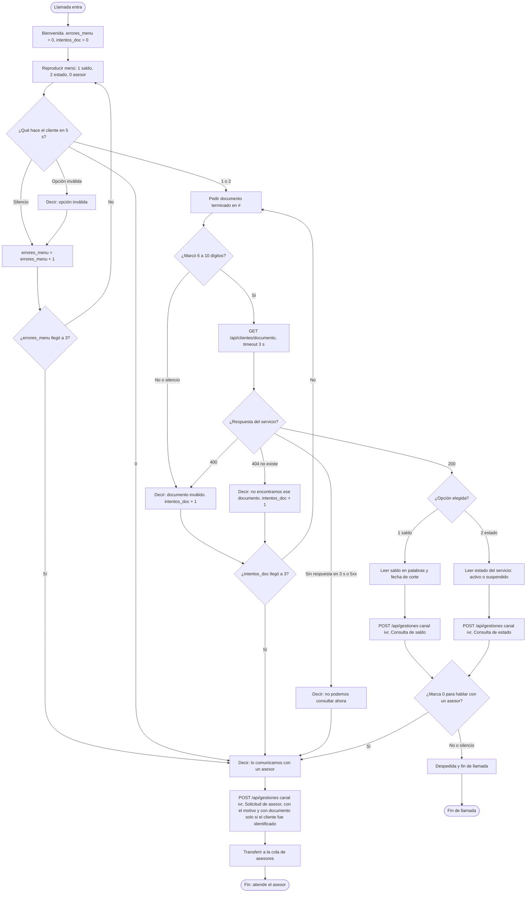

# IVR de consulta de saldo y estado (B3)

Diseño del flujo telefónico de TeleAndes. El IVR no tiene lógica de negocio propia: consulta el mismo web service que usan el formulario del agente y el bot, y registra cada atención como una gestión con canal `ivr`.

## 1. Reglas y supuestos

**Menú principal** (reglas del ejercicio A2):

| Situación | Resultado |
|---|---|
| Opciones válidas: `1` saldo, `2` estado, `0` asesor | Sigue el flujo de la opción |
| 5 segundos sin marcar nada | Cuenta un error y repite el menú |
| Opción inválida | Dice "opción inválida", cuenta un error y repite el menú |
| Errores acumulados (silencios más opciones inválidas) | Al tercero transfiere a un asesor |

**Documento**: se pide terminado en `#`, debe tener de 6 a 10 dígitos y hay hasta 3 intentos; al tercer intento fallido se transfiere a un asesor.

**Web service**: espera máxima de 3 segundos.

| Respuesta del servicio | Acción del IVR |
|---|---|
| 200 | Lee el resultado |
| 400 (documento mal formado) | Intento fallido. No debería ocurrir, porque el IVR valida antes |
| 404 (cliente no existe) | Intento fallido: avisa y vuelve a pedir el documento |
| 5xx, 503 o sin respuesta en 3 s | Informa que no puede consultar y transfiere a un asesor |

**Supuestos**

1. El enunciado de B3 cita "las reglas de errores del ejercicio A3", pero esas reglas están en A2. Se asume A2.
2. Una llamada atiende una consulta: tras leer el resultado se ofrece hablar con un asesor (`0`) o terminar.
3. El silencio al pedir el documento (5 s) cuenta como intento fallido, igual que un documento con longitud incorrecta.
4. Los intentos de documento (máximo 3) son independientes de los errores del menú (máximo 3). Los intentos incluyen los 404.
5. Toda transferencia a un asesor registra una gestión con canal `ivr` y tipificación "Solicitud de asesor", haya o no un cliente identificado. Con cliente identificado (la API respondió 200) se envía el `documento`. Sin cliente (opción `0` en el menú, errores del menú, tres intentos de documento fallidos o servicio caído) se envía la gestión **sin documento**: la API lo admite para el canal `ivr` y entonces exige una observación con el motivo, por ejemplo "Transferida al asesor tras 3 errores en el menú". Un documento que el cliente digitó pero no quedó identificado (404 o servicio caído) no se envía, porque la API respondería 404 por cliente inexistente. Las gestiones sin documento no aparecen en el listado por cliente de la API; un listado para reportes queda como pendiente.
6. El registro de la gestión es de mejor esfuerzo: con timeout de 3 s, y si falla no se bloquea ni se le avisa al cliente; se escribe en el log del IVR.
7. El IVR envía `Idempotency-Key` con el identificador único de la llamada más el paso, para que un reintento de red no duplique la gestión.

## 2. Diagrama de flujo



## 3. Pseudocódigo

```text
MAX_ERRORES_MENU  = 3
MAX_INTENTOS_DOC  = 3
SEGUNDOS_SILENCIO = 5
TIMEOUT_SERVICIO  = 3      # segundos, en cada llamada a la API

funcion atender_llamada(id_llamada):
    errores_menu    = 0
    intentos_doc    = 0
    cliente         = nulo

    reproducir("bienvenida")

    # --- Menú principal ---
    mientras verdadero:
        opcion = leer_tecla(menu_principal, espera = SEGUNDOS_SILENCIO)

        si opcion es "0":
            ir a transferir_a_asesor("el cliente pidió un asesor tras la consulta")("3 intentos de documento fallidos")("servicio no disponible")("3 errores en el menú")("el cliente marcó 0 en el menú")
        si opcion es "1" o "2":
            detener el menú y seguir con el documento
        si opcion es vacía:                       # silencio
            errores_menu += 1
        si no:                                    # cualquier otra tecla
            reproducir("opcion invalida")
            errores_menu += 1

        si errores_menu >= MAX_ERRORES_MENU:
            ir a transferir_a_asesor

    # --- Documento ---
    mientras cliente es nulo:
        documento = leer_digitos(pedir_documento, max = 11, terminador = "#",
                                 espera = SEGUNDOS_SILENCIO)
        # max = 11 para que un documento de 11 dígitos falle la validación
        # en lugar de truncarse a 10 y parecer válido.

        si no coincide(documento, "^[0-9]{6,10}$"):
            reproducir("documento invalido")
            intentos_doc += 1
        si no:
            resultado = consultar_cliente(documento)       # ver abajo
            elegir resultado.tipo:
                "ok":          cliente = resultado.cliente
                "no_existe":   reproducir("no encontramos ese documento")
                               intentos_doc += 1
                "invalido":    intentos_doc += 1            # 400, no esperado
                "no_disponible": reproducir("no podemos consultar ahora")
                               ir a transferir_a_asesor

        si cliente es nulo y intentos_doc >= MAX_INTENTOS_DOC:
            ir a transferir_a_asesor

    # --- Lectura del resultado ---
    si opcion es "1":
        decir(texto_saldo(cliente.saldo, cliente.fecha_corte))
        tipificacion = "Consulta de saldo"
    si no:
        decir(texto_estado(cliente.estado))
        tipificacion = "Consulta de estado"

    registrar_gestion(cliente.documento, tipificacion,
                      "Consulta atendida por IVR", clave = id_llamada + "-consulta")

    si leer_tecla("para hablar con un asesor marque 0", espera = SEGUNDOS_SILENCIO) es "0":
        ir a transferir_a_asesor
    reproducir("despedida")
    colgar()

transferir_a_asesor(motivo):
    reproducir("lo comunicamos con un asesor")
    # Siempre se registra. El documento va solo si el cliente quedó identificado;
    # sin documento, la observación con el motivo es obligatoria en la API.
    documento = cliente.documento si cliente no es nulo, si no nulo
    registrar_gestion(documento, "Solicitud de asesor",
                      "Transferida al asesor: " + motivo, clave = id_llamada + "-asesor")
    transferir(cola_asesores)


funcion consultar_cliente(documento):
    intentar:
        r = GET("/api/clientes/" + documento, timeout = TIMEOUT_SERVICIO)
    si falla por timeout o red:
        devolver {tipo: "no_disponible"}
    elegir r.estado:
        200:      devolver {tipo: "ok", cliente: r.cuerpo}
        404:      devolver {tipo: "no_existe"}
        400:      devolver {tipo: "invalido"}
        >= 500:   devolver {tipo: "no_disponible"}
        otro:     devolver {tipo: "no_disponible"}

funcion registrar_gestion(documento, tipificacion, observacion, clave):
    cuerpo = {canal: "ivr", tipificacion, observacion}
    si documento no es nulo:
        cuerpo.documento = documento
    intentar:
        POST("/api/gestiones",
             cuerpo = cuerpo,
             cabecera = {"Idempotency-Key": clave}, timeout = TIMEOUT_SERVICIO)
    si falla o responde distinto de 201 o 200:
        escribir_log("no se pudo registrar la gestión", ultimos_4_digitos(documento), clave)
        # No se le dice nada al cliente: la atención ya ocurrió.
```

Dos detalles del comportamiento:

- **Contadores separados.** Un cliente puede gastar sus 3 errores de menú y, ya identificado, otros 3 intentos de documento. Es el comportamiento más simple de explicar y de probar; unificarlos sería un cambio de regla de negocio.
- **Documento en el log.** Solo se registran los últimos 4 dígitos, igual que en Andi.

## 4. Lectura en voz: números y fechas

**Por qué falla leer el dato tal cual.** El motor de voz (TTS) interpreta el texto sin saber que es dinero ni fecha:

- `85000` o `"85.000"` puede leerse dígito por dígito ("ocho cinco cero cero cero"), o con el punto como decimal ("ochenta y cinco punto cero cero cero"). Depende del motor y del idioma configurado, y no se puede garantizar.
- `2026-10-20` se lee como una secuencia de números y signos ("dos mil veintiséis guion diez guion veinte") o, peor, como una resta. El orden día-mes-año de Colombia tampoco coincide con el ISO año-mes-día, así que un `10/11` sería ambiguo.
- El valor llega del servicio en un formato pensado para máquinas (entero y `AAAA-MM-DD`), no para ser dicho.

**Solución.** La conversión se hace en el IVR, antes de la voz, para que el resultado no dependa del motor:

| Dato del servicio | Texto armado por el IVR | Lo que se escucha |
|---|---|---|
| `saldo: 85000` | `"ochenta y cinco mil pesos"` | ochenta y cinco mil pesos |
| `saldo: 120500` | `"ciento veinte mil quinientos pesos"` | ciento veinte mil quinientos pesos |
| `saldo: 0` | `"no tiene saldo pendiente"` | no tiene saldo pendiente |
| `fecha_corte: "2026-10-20"` | `"veinte de octubre"` | veinte de octubre |

1. **Número a palabras en el código.** Una función `numero_a_palabras(entero)` que cubra los casos del español: el `un` apocopado ("veintiún mil", "un millón"), "cien" frente a "ciento", y que diga "pesos" (o "un peso" para 1). Se prueba con valores fijos (0, 1, 21, 100, 1000, 85000, 120500, 1000000).
2. **Fecha en palabras.** Se separa `AAAA-MM-DD` a mano (nunca `new Date(texto)` ni una librería que asuma UTC, que corre el día) y se arma "día en palabras de mes". El año se omite porque la fecha de corte siempre es próxima; si hiciera falta se agrega "de dos mil veintiséis".
3. **Alternativa con SSML, si el motor la soporta.** Algunos motores de TTS aceptan `say-as`, por ejemplo `<say-as interpret-as="currency" language="es-CO">85000</say-as>` y `<say-as interpret-as="date" format="dmy">20-10-2026</say-as>`. El soporte y el resultado cambian de un motor a otro (y para es-CO no siempre hay voz con moneda correcta), por eso es una segunda opción que hay que probar, no la base.
4. **En Asterisk**: `SayNumber(85000)` con `CHANNEL(language)=es` reproduce las grabaciones en español del número y luego se agrega la grabación de "pesos". Para la fecha, `SayUnixTime` con formato de día y mes. Si en cambio se usa TTS, se le entrega el texto ya armado como en la tabla.

## 5. Plus: `extensions.conf` de Asterisk (ilustrativo)

> Ilustrativo: **no se probó en un Asterisk real**. Los nombres de grabaciones (`teleandes/...`), la cola `asesores` y la función `JSON_DECODE` (requiere `func_json`) dependen de la instalación. Sirve para mostrar la lógica: `Read`, contador de errores, `CURL` con timeout y `GotoIf`.

```ini
[ivr-teleandes]
exten => s,1,NoOp(IVR TeleAndes llamada ${UNIQUEID})
 same => n,Answer()
 same => n,Set(CHANNEL(language)=es)
 same => n,Set(ERRORES=0)
 same => n,Set(INTENTOS_DOC=0)
 same => n,Set(DOC_ID=)                                       ; solo se llena si el cliente queda identificado
 same => n,Set(MOTIVO=)
 same => n,Playback(teleandes/bienvenida)

; --- Menú: 1 dígito, un intento, 5 s de espera ---
 same => n(menu),Read(OPCION,teleandes/menu,1,,1,5)
 same => n,GotoIf($["${OPCION}"=""]?error)             ; silencio
 same => n,GotoIf($["${OPCION}"="0"]?asesor_cero)
 same => n,GotoIf($["${OPCION}"="1"]?pedir_doc)
 same => n,GotoIf($["${OPCION}"="2"]?pedir_doc)
 same => n,Playback(teleandes/opcion-invalida)
 same => n(error),Set(ERRORES=$[${ERRORES} + 1])
 same => n,GotoIf($[${ERRORES} >= 3]?asesor_errores)
 same => n,Goto(menu)

; --- Documento: hasta 11 dígitos y # (11 hace fallar uno de 11 en vez de truncarlo) ---
 same => n(pedir_doc),Read(DOC,teleandes/pedir-documento,11,,1,5)
 same => n,GotoIf($[${REGEX("^[0-9]{6,10}$" ${DOC})}]?consultar)
 same => n,Playback(teleandes/documento-invalido)
 same => n(falla_doc),Set(INTENTOS_DOC=$[${INTENTOS_DOC} + 1])
 same => n,GotoIf($[${INTENTOS_DOC} >= 3]?asesor_doc)
 same => n,Goto(pedir_doc)

; --- Web service: 3 s. CURL() no entrega el código HTTP; se decide por el cuerpo ---
 same => n(consultar),Set(CURLOPT(conntimeout)=3)
 same => n,Set(CURLOPT(httptimeout)=3)
 same => n,Set(RESP=${CURL(http://teleandes_api:8000/api/clientes/${DOC})})
 same => n,GotoIf($["${RESP}"=""]?falla_servicio)       ; timeout o sin respuesta
 same => n,Set(NOMBRE=${JSON_DECODE(RESP,nombre)})
 same => n,GotoIf($["${NOMBRE}"!=""]?leer)               ; 200: trae nombre
 same => n,Set(MSG=${JSON_DECODE(RESP,error)})
 same => n,GotoIf($["${MSG:0:9}"="No existe"]?no_existe) ; 404
 same => n,Goto(falla_servicio)                          ; cualquier otro error: 5xx

 same => n(no_existe),Playback(teleandes/documento-no-encontrado)
 same => n,Goto(falla_doc)                               ; 404 cuenta como intento fallido

 same => n(falla_servicio),Playback(teleandes/servicio-no-disponible)
 same => n,Goto(asesor_servicio)

; --- Lectura del resultado ---
 same => n(leer),Set(DOC_ID=${DOC})
 same => n,Set(SALDO=${JSON_DECODE(RESP,saldo)})
 same => n,Set(CORTE=${JSON_DECODE(RESP,fecha_corte)})
 same => n,Set(ESTADO=${JSON_DECODE(RESP,estado)})
 same => n,GotoIf($["${OPCION}"="2"]?leer_estado)
 same => n,GotoIf($["${SALDO}"="0"]?sin_saldo)
 same => n,Playback(teleandes/su-saldo-es)
 same => n,SayNumber(${SALDO})                            ; "ochenta y cinco mil"
 same => n,Playback(teleandes/pesos)
 same => n,Playback(teleandes/fecha-de-corte)
 same => n,Set(EPOCH=${STRPTIME(${CORTE},America/Bogota,%Y-%m-%d)})
 same => n,SayUnixTime(${EPOCH},America/Bogota,d 'digits/de' B)   ; "veinte de octubre"
 same => n,Set(TIPIF=Consulta de saldo)
 same => n,Goto(registrar)
 same => n(sin_saldo),Playback(teleandes/sin-saldo-pendiente)
 same => n,Set(TIPIF=Consulta de saldo)
 same => n,Goto(registrar)
 same => n(leer_estado),GotoIf($["${ESTADO}"="suspendido"]?suspendido)
 same => n,Playback(teleandes/servicio-activo)
 same => n,Set(TIPIF=Consulta de estado)
 same => n,Goto(registrar)
 same => n(suspendido),Playback(teleandes/servicio-suspendido)
 same => n,Set(TIPIF=Consulta de estado)

; --- Registro de la gestión: script con curl, mejor esfuerzo ---
 same => n(registrar),System(/opt/teleandes/registrar_gestion.sh "${DOC_ID}" "${TIPIF}" "Consulta atendida por IVR" ${UNIQUEID}-consulta)
 same => n,Read(MAS,teleandes/marque-0-asesor,1,,1,5)
 same => n,GotoIf($["${MAS}"="0"]?asesor_consulta)
 same => n,Playback(teleandes/despedida)
 same => n,Hangup()

; --- Transferencia: cada camino fija el motivo y todos registran la gestión ---
 same => n(asesor_cero),Set(MOTIVO=el cliente marcó 0 en el menú)
 same => n,Goto(asesor)
 same => n(asesor_errores),Set(MOTIVO=3 errores en el menú)
 same => n,Goto(asesor)
 same => n(asesor_doc),Set(MOTIVO=3 intentos de documento fallidos)
 same => n,Goto(asesor)
 same => n(asesor_servicio),Set(MOTIVO=servicio no disponible)
 same => n,Goto(asesor)
 same => n(asesor_consulta),Set(MOTIVO=el cliente pidió un asesor tras la consulta)
 same => n(asesor),Playback(teleandes/transferir-asesor)
 same => n,System(/opt/teleandes/registrar_gestion.sh "${DOC_ID}" "Solicitud de asesor" "Transferida al asesor: ${MOTIVO}" ${UNIQUEID}-asesor)
 same => n,Queue(asesores)
 same => n,Hangup()
```

`CURL()` no permite fijar cabeceras ni cuerpo JSON de forma cómoda, y el `POST` necesita `Content-Type: application/json` y `Idempotency-Key`. Por eso el registro va en un script auxiliar:

```sh
#!/bin/sh
# Uso: registrar_gestion.sh DOCUMENTO TIPIFICACION OBSERVACION CLAVE
# DOCUMENTO puede ir vacío: la gestión se envía sin documento (la API lo admite para ivr).
# El documento llega ya validado (solo dígitos) y el resto son textos fijos del dialplan,
# por lo que no hay inyección en el JSON.
if [ -n "$1" ]; then
  DOCUMENTO="\"documento\":\"$1\","
else
  DOCUMENTO=""
fi
curl -s -m 3 -o /dev/null -X POST "http://teleandes_api:8000/api/gestiones" \
  -H "Content-Type: application/json" \
  -H "Idempotency-Key: $4" \
  -d "{${DOCUMENTO}\"canal\":\"ivr\",\"tipificacion\":\"$2\",\"observacion\":\"$3\"}" \
  || logger -t ivr-teleandes "no se pudo registrar la gestion $4"
```

## 6. Qué no cubre este diseño

- Reintentos automáticos si el servicio falla: se transfiere de inmediato, por la regla de los 3 segundos.
- Idiomas distintos del español, o el cliente que marca desde un teléfono que no envía tonos DTMF (habría que ofrecer reconocimiento de voz).
- Autenticación del cliente más allá del documento: el servicio de consulta de TeleAndes tampoco la exige hoy y queda como pendiente del proyecto.
